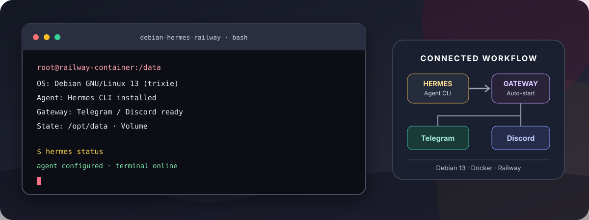
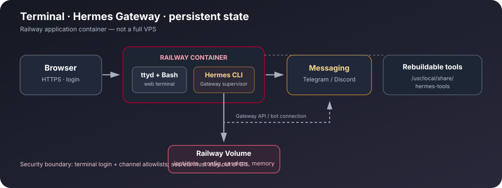

<div align="center">

<a href="https://www.debian.org/"></a>&nbsp;&nbsp;&nbsp;&nbsp;<a href="https://github.com/NousResearch/hermes-agent"></a>

# Debian + Hermes Agent Railway

<p>
  <a href="https://github.com/DURIAN-ORGANISASI/debian-hermes-railway/actions/workflows/docker-build.yml"></a>
  
  
  
  
  <a href="LICENSE"></a>
</p>

<p><a href="README.md">🇮🇩 Bahasa Indonesia</a> · <a href="README.en.md">🇬🇧 English</a></p>

<p><strong>Hermes Agent and a Debian 13 terminal on Railway.</strong><br>
Deploy Hermes CLI, access a browser-based shell, and connect Telegram/Discord with persistent configuration storage.</p>

<p>
  <a href="#features">Features</a> ·
  <a href="#architecture-overview">Architecture</a> ·
  <a href="#quick-deploy">Quick deploy</a> ·
  <a href="#persistent-state-and-auto-start">Persistent state</a> ·
  <a href="#security">Security</a> ·
  <a href="#sources-attribution-and-license">Sources &amp; license</a> ·
  <a href="#contributing">Contributing</a>
</p>

</div>

---



<p align="center"><sub>Original vector artwork for this repository's documentation; not an official product screenshot.</sub></p>

> [!WARNING]
> **This is not a full VPS.** Railway runs an application container, not a virtual server with host access, a desktop GUI, or guaranteed full systemd support. The web terminal runs as root inside the container. Attach a Railway Volume at `/opt/data` before the first Hermes setup so configuration, sessions, memory, and logs survive container recreation.

## Architecture overview



- **Terminal access:** Browser HTTPS → Railway → `ttyd` → Bash inside the Debian 13 container.
- **Agent and channels:** Hermes Gateway runs in the container and can connect Telegram/Discord bots after configuration.
- **Persistent state:** A Railway Volume at `/opt/data` stores Hermes configuration and state; rebuildable tools and caches are kept outside the volume.
- **Auto-start:** The entrypoint starts the Gateway after `/opt/data/config.yaml` exists when `HERMES_AUTOSTART=true`.

## Features

- Debian 13 (Trixie slim) base image.
- Hermes Agent CLI is installed during Docker build using the upstream installer.
- Messaging, Telegram, and Discord extras are installed and checked at build time.
- Browser terminal powered by ttyd with username/password authentication and WebSocket Origin checking.
- Automatic system banner with OS, kernel, architecture, uptime, CPU, memory, disk, timezone, and Gateway status.
- Git, curl, Python, pip/venv, compiler toolchain, and build libraries.
- Optional Gateway auto-start after Hermes configuration has been created.
- Default timezone: `Asia/Jakarta`.
- Hermes state at `/opt/data`; rebuildable tool and cache data live outside persistent storage.
- ttyd binaries for AMD64 and ARM64.
- GitHub Actions checks shell syntax, builds the image, and tests terminal authentication.

## Quick deploy

1. In Railway, select **New Project → Deploy from GitHub Repo** and choose this repository.
2. Build from the root `Dockerfile`; a custom Start Command is usually unnecessary because the image defines an `ENTRYPOINT`.
3. Create a Railway Volume with its mount path set exactly to `/opt/data` **before running the initial Hermes setup**.
4. Add the variables below and deploy.
5. Under **Settings → Networking → Generate Domain**, create a public domain for the terminal.
6. Check Build Logs and Deploy Logs, then sign in to the terminal.

## Railway variables

Add these in **Railway → Service → Variables**. Replace the placeholder username and password before deploying:

```dotenv
TERMINAL_USER=REPLACE_WITH_UNIQUE_USERNAME
TERMINAL_PASSWORD=REPLACE_WITH_RANDOM_PASSWORD_AT_LEAST_24_CHARACTERS
TZ=Asia/Jakarta
HERMES_HOME=/opt/data
HERMES_RUNTIME_DIR=/usr/local/share/hermes-tools
UV_CACHE_DIR=/tmp/uv-cache
HERMES_AUTOSTART=true
```

| Variable | Purpose |
| --- | --- |
| `TERMINAL_USER` | Required login username; must not contain a colon (`:`). |
| `TERMINAL_PASSWORD` | Required unique password, at least 16 characters; 24–40 characters or longer is recommended. |
| `TZ` | Optional timezone; defaults to `Asia/Jakarta`. |
| `HERMES_HOME` | Persistent Hermes state directory. Keep it at `/opt/data` when the Volume is mounted there. |
| `HERMES_RUNTIME_DIR` | Rebuildable tool runtime; keep it outside `/opt/data`. |
| `UV_CACHE_DIR` | Disposable package cache; defaults to `/tmp/uv-cache`. |
| `HERMES_AUTOSTART` | Starts the Gateway when set to `true` or `1` and a Hermes config exists. |
| `PORT` | Injected by Railway. Do not set it manually; the local fallback is 8080. |

See [`.env.example`](.env.example) for a reference template. Never commit real passwords, provider API keys, or bot tokens. Avoid creating empty or placeholder token variables in Railway if you already configured the real values through the Hermes wizard.

## First-time Hermes setup

Attach the Volume at `/opt/data` before doing this the first time. Open the Railway terminal and run:

```bash
command -v hermes
hermes --version
hermes setup
```

Wizard choices and labels can vary between Hermes versions. Select a model/provider for which you have valid credentials; keep the terminal backend local; skip optional image generation until needed; choose the tools/search provider you actually have credentials for; and decline shared telemetry if you do not want it. Never enter a placeholder such as `YOUR_API_KEY` as a real credential.

After setup, check:

```bash
hermes doctor
hermes status
hermes gateway setup
```

Use the Gateway setup wizard to configure Telegram and/or Discord. Follow the provider's authorization prompts and use numeric platform-specific user IDs where requested. A Telegram user ID is not a Discord channel ID. For a Discord server, the bot also needs the proper channel permissions and the **Message Content Intent** in the Discord Developer Portal.

After the wizard creates `/opt/data/config.yaml`, restart or redeploy the Railway service once. With `HERMES_AUTOSTART=true`, the repository entrypoint supervises the Gateway; do not start a second Gateway manually using the same bot token.

## Configure Telegram

1. Open Telegram and message `@BotFather`.
2. Send `/newbot`, follow its prompts, and store the token securely.
3. From the Railway terminal run `hermes gateway setup`, choose Telegram, and enter the real BotFather token.
4. Complete pairing/allowlist setup if prompted, restart the Railway service, then open the bot chat and send `/start` followed by a regular message.
5. If pairing is required, use the real pairing code shown by the bot:

```bash
hermes pairing list
hermes pairing approve telegram REAL_PAIRING_CODE
```

Replace `REAL_PAIRING_CODE` with the actual code; do not copy the placeholder literally. Do not run two active Gateways with the same Telegram bot token.

## Configure Discord

1. Create an application at https://discord.com/developers/applications and create/copy its bot token securely.
2. Under **Bot → Privileged Gateway Intents**, enable **Message Content Intent**. Enable **Server Members Intent** if your access policy requires it or the error explicitly requests it.
3. Under **OAuth2 → URL Generator**, select `bot` and `applications.commands`, grant only needed permissions (at least View Channels, Send Messages, and Read Message History), and invite the bot to the correct server.
4. Enable Discord Developer Mode and use **Copy User ID** for your numeric user ID.
5. Run `hermes gateway setup` in the Railway terminal, choose Discord, enter the real bot token, and allow your own account when asked.
6. Ensure your user ID is authorized and the bot can view the channel. Start with a DM; in a server channel, mention the bot explicitly because normal messages may be ignored by default.

A bot token authenticates the bot; `DISCORD_ALLOWED_USERS` authorizes users. If Telegram works but Discord does not, focus on Discord's token, intents, allowlist, channel permissions, and mention behavior.

## Persistent state and auto-start

- `/opt/data`: persistent Hermes config, sessions, memory, and logs.
- `/data`: terminal working directory; not persistent unless you attach a separate Volume there.
- `/usr/local/share/hermes-tools`: rebuildable runtime tools kept outside the persistent Volume.
- `/tmp/uv-cache`: disposable cache.

Gateway auto-start only happens when `HERMES_AUTOSTART=true` (or `1`) and `/opt/data/config.yaml` exists at container start. If you finish setup while the service is already running, restart/redeploy after setup. The entrypoint retries the Gateway if it exits.

## Streaming and latency

Streaming changes how partial answers are displayed; it does not guarantee a faster first token from a slow model/provider. To enable Telegram streaming, run:

```bash
hermes config set streaming.enabled true
hermes config set display.platforms.telegram.streaming true
hermes config get streaming.enabled
hermes config get display.platforms.telegram.streaming
hermes config get display.platforms.discord.streaming
```

To test the model from the terminal:

```bash
hermes -c "Reply with only: OK"
```

If CLI and Telegram are both slow, test a faster model through `hermes model` and consider lower reasoning if the model supports it. If CLI is fast but Telegram is slow, check the active model, Gateway configuration, and logs. Optional reasoning adjustment:

```bash
hermes config set agent.reasoning_effort low
hermes config get agent.reasoning_effort
```

This setting may reduce reasoning time for supported models, with possible quality trade-offs; it does not guarantee a latency improvement.

## Troubleshooting

| Symptom | What to check |
| --- | --- |
| Gateway stays stopped | Confirm `HERMES_AUTOSTART=true`, the Volume is mounted at `/opt/data`, and `/opt/data/config.yaml` exists. Restart the service and inspect Deploy Logs for the Gateway supervisor messages. |
| Terminal login fails/restarts | Set `TERMINAL_USER` and `TERMINAL_PASSWORD`; username cannot contain `:` and password must be at least 16 characters. |
| Configuration disappears | Mount the Volume at exactly `/opt/data` before first setup. A Volume mounted only at `/data` does not persist Hermes config. |
| Hermes command is missing | Inspect Build Logs and verify the image was built from the latest commit. |
| Telegram does not respond | Verify the BotFather token, allowed user/pairing, Gateway status, and that no second Gateway is using the same token. |
| Discord is connected but ignores messages | Enable Message Content Intent, authorize your numeric user ID, verify channel permissions, and mention the bot in server channels. |
| `PrivilegedIntentsRequired` | Enable Message Content Intent in the Discord Developer Portal; enable Server Members Intent if required by the selected access policy. |
| `No Discord access policy configured` / `User not allowed` | Re-run `hermes gateway setup` or check that `DISCORD_ALLOWED_USERS` contains the correct numeric Discord user ID. Avoid enabling unrestricted access on a public bot. |
| Model waits for `first_chunk` | Run a one-shot CLI test; check model/provider latency and Gateway logs. Streaming settings alone do not speed up model output. |
| Other providers warn about missing login | Review the provider listed by `hermes status`; warnings for unused providers do not automatically mean the active provider failed. |

For deeper diagnostic notes, see the detailed [Indonesian README](README.md).

## Security

- The public web terminal grants root privileges inside the container; use a long, unique password.
- Keep bot tokens and model API keys in Railway Variables or the Hermes setup wizard; never commit them.
- If a token is exposed, revoke/rotate it in the provider's portal immediately.
- Do not grant unrestricted access to public bots that can use tools or operate on files.
- A Railway Volume provides persistence, not backup or access control.
- Railway resource limits and application-container restrictions still apply; this is not a full VPS.

## Sources, attribution, and license

See [`docs/SOURCES.md`](docs/SOURCES.md) for upstream components, logo attribution, original artwork, and license scope. Project materials covered by this repository are released under the [MIT License](LICENSE). Debian's logo, Hermes Agent, ttyd, packages, Railway, Docker, and other third-party components remain subject to their respective upstream terms.

## Contributing

Issues and Pull Requests are welcome. Read [`CONTRIBUTING.md`](CONTRIBUTING.md) before proposing changes, and never include credentials or logs containing secrets.

## Security policy

To report a potential vulnerability, follow [`SECURITY.md`](SECURITY.md). Avoid publicly disclosing bot tokens, Railway credentials, private domains, or sensitive configuration.

## Repository structure

```text
debian-hermes-railway/
├── Dockerfile
├── entrypoint.sh
├── start-hermes
├── system-banner.sh
├── .env.example
├── LICENSE
├── README.md
├── README.en.md
├── CONTRIBUTING.md
├── SECURITY.md
├── docs/
│   ├── hero.id.svg
│   ├── hero.en.svg
│   ├── architecture.svg
│   ├── architecture.en.svg
│   └── SOURCES.md
└── .github/workflows/docker-build.yml
```

---

<div align="center">
  <sub>Debian + Hermes Agent Railway — a browser-accessible terminal with persistent agent state.</sub>
</div>
